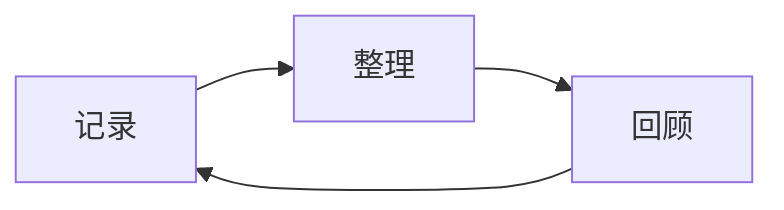

# 欢迎使用墨屿

笔记以 Markdown 文件保存。点击底部“笔记”查看文件，点击文件夹展开或收起；层级缩进保留当前位置。列表顶部的加号在当前选中的文件夹中创建文档或文件夹。

主页搜索框查找当前知识库的标题和正文。点击结果或匹配行，在阅读视图定位；返回主页后保留搜索条件。清空搜索恢复文件列表及已展开的文件夹。

返回列表保留展开的文件夹和滚动位置。长按文件或文件夹进入多选，也可从文件菜单选择“选择多个”；底部可以批量移动、分享文件或移入回收站。选中的文件夹会包含其子项，文件夹本身不支持分享。移动时先检查同名文件，不会直接覆盖。

## 开始书写

启动应用和打开文件时均使用阅读视图。需要修改时，点击上方“编辑”或“源码”，再点击正文开始输入；切换视图不会自动弹出键盘。编辑区下方的工具栏是格式和插入操作的快捷入口，可以左右滑动。“全部格式”包含行内公式、表格、代码块和默认展开或折叠的引用。标题使用 `#` 输入，列表使用 `-` 或 `1.` 输入。

加号打开全部格式；附件位于其中的“插入”分组。在“全部格式 → 工具栏”或“设置 → 编辑工具栏”中，添加、移除或排序任意格式和插入操作，数量不限，设置会保留。打开格式面板时收起键盘，取消面板后不会自动弹出；选择格式后回到选区继续编辑。系统返回先收起键盘，再返回上一级面板或返回列表。

撤销、重做位于顶部文件信息栏，点击时保留键盘原有的展开或收起状态。视图切换右侧的减号、加号调整正文字号，范围 10–24 px，与设置页一致，不改变界面字号。

“折叠引用”插入默认折叠的引用；光标位于折叠引用时，使用“默认展开”或“默认折叠”切换默认状态，嵌套时只改变内层引用。“标签页”插入包含两页的代码块。

光标进入代码、表格、图片、列表或引用时，下方工具栏显示相应操作：增删表格行列、调整列表层级、去除一层引用和切换默认展开状态。“块后换行”在当前代码、表格或图片后插入段落，列表中的段落保留原有层级。表格上下文还提供“复制表格”。格式面板中的操作可以固定到工具栏，不能执行时按钮禁用。

阅读时可用“专注阅读”隐藏顶部文件信息栏；再次点击还原。同一篇尚未关闭的文档会保留本次会话的阅读位置。宽表格在自己的区域内左右滑动；代码块右上角可以复制代码。点击图片、绘图或图表全屏查看，双击或双指缩放，放大后滑动查看细节。

**加粗**、*斜体*、==高亮==、__下划线__，都可以在编辑和阅读视图中显示。

- [ ] 整理今天的想法
- [ ] 写一份阅读笔记
- [ ] 添加一张照片

> [+] 折叠引用
> 点击标题前的小箭头可以收起内容。
>
> 折叠引用也可以嵌套。

## 文档与文件夹

“新建文档”允许填写扩展名；没有扩展名时使用 `.md`。文件右侧的菜单提供重命名、移动和删除。删除的文件会进入回收站，可以在“设置”中恢复。

列表顶部的眼睛按钮切换附件和数据目录的显示，不改变同步范围。文件菜单中的“详情”显示路径、大小、时间和同步状态。

知识库默认保存在应用内。若要直接使用设备上的 Markdown 文件夹，在“设置 → 知识库”中选择设备上的文件夹，并授予文件夹访问权限。设备文件夹在卸载应用后仍保留；应用内知识库请在卸载前导出。

## 保存与历史

默认停止输入后自动保存。可在“设置 → 编辑 → 保存方式”切换为离开时保存或手动保存。手动模式仅在点击“保存”或确认保存时写入文档；切换视图、返回列表、进入后台、同步均不会保存。未保存内容保留为本机恢复草稿，不参与同步。顶部“保存”仅保存当前文档。

“已打开的文档”中可以逐篇关闭，也可选择“全部关闭”；手动模式下遇到未保存内容时，可保存、放弃修改或取消关闭。

在文档菜单中打开“文档历史”，可比较历史版本并恢复内容。历史记录位于应用的私有目录，保留 30 天，每篇文档最多 100 条。

## 附件

在编辑或源码视图中，点击“加号 → 插入附件”，选择图片或文件；也可把附件按钮固定到工具栏。附件保存在文档旁的 `.assets/attachments` 文件夹中，正文使用相对链接引用。

文档改名或移动时，配套 `.assets` 目录随行，文档中的引用会更新。删除文档时，配套目录一同移入回收站。暂时没有引用的附件会保留，不会自动清理。代码块数据位于 `.assets/code-data`，安卓版不执行代码，但可同步这些文件。

## WebDAV

在“设置 → WebDAV 同步”中分别填写 HTTPS 服务地址、同步目录、用户名和密码。例如坚果云服务地址为 `https://dav.jianguoyun.com/dav/`，同步目录为 `/Moyu`，最终同步地址为 `https://dav.jianguoyun.com/dav/Moyu/`。页面会显示最终地址，核对目录后再同步。目录填 `/` 表示服务地址下的全部文件。“测试”检查连接，“立即同步”同步文件。

文件和文件夹旁显示同步状态；首页“立即同步”直接同步当前知识库。未配置连接时进入设置，有冲突时进入处理界面。状态依据最近一次同步或云端目录检查，修改保存后显示“待同步”。

切换同步目录或首次同步服务根目录时，先确认同步范围；取消后不传输文件。手机内容将覆盖云端已有文件时，会列出文件并再次确认，取消后保留原文件。自动同步会暂缓这类上传，可在首页点击“立即同步”确认。

“立即同步”右侧的菜单显示同步时间、冲突数量和失败详情，可以进入同步设置或单独处理冲突。

默认同步笔记、附件和代码数据。“同步选项”提供代码数据开关、排除规则、删除策略、超时、重试与单文件大小上限。默认删除前确认；两端都有修改时，可比较差异并选择保留本地、使用云端或保留两份。

默认手动同步。“启动或回到前台时同步”在应用启动、切换知识库或回到前台后触发；也可启用保存后同步和定时同步。自动同步只在前台运行，处理已保存的文件，至少间隔 30 秒；期间的保存合并处理，首次需手动同步。

启用“保存后同步”后，同步期间再次保存的修改会在当前同步结束后继续同步。进入后台会中断正在进行的自动同步；后台保存的修改会等到回到前台再同步。

“设置 → 界面”调整外观、配色和界面字号；“设置 → 字体与排版”调整正文字号、代码块字号、行高和表格缩放。字号最低为 10。界面字号作用于菜单和列表，正文字号作用于阅读、编辑及源码视图。代码块字号独立调整阅读与编辑中的代码块，包括多标签代码块；上方的加减字号按钮只调整正文。“设置 → 编辑”调整保存方式和样式快捷栏顺序。

“代码块自动换行”默认开启，适用于阅读和编辑中的普通代码块、多标签代码块；关闭后长行可在块内左右滑动。代码块显示行号，复制代码不包含行号。Mermaid 阅读图表不显示代码复制栏。

“表格缩放”调整阅读和编辑视图的表格文字与单元格大小，不改变文档内容。

## 代码与图表

代码块支持编辑、着色和阅读，安卓版不执行代码，也不提供终端。

```javascript
const words = ["记录", "整理", "回顾"];
console.log(words.join(" → "));
```

Mermaid 图表和数学公式可离线显示：



$$
\sum_{k=1}^{n}k=\frac{n(n+1)}{2}
$$

WebDAV 返回 429 或持续返回 503 时会暂停请求；服务器指定等待时间时按该时间重试，否则先等待一分钟，持续失败时延长等待。手动点击同步也不会跳过等待。处理冲突只检查当前文件，不重新扫描其他目录。

同步前会检查所有已打开文档。存在未保存修改时，选择保存并继续、放弃修改或取消同步；自动同步会等到草稿处理完再运行。覆盖云端前可逐文件对比，也可选择使用云端覆盖本地。Excalidraw 文件以两张绘图比较。处理冲突使用单独页面，不会自动跳转。

进度中的“检查文件变化”只比较本地文件与云端元数据；上传、下载只传输需要更新的文件。

代码块底边需长按 1 秒后拖动才能调整高度，双击恢复默认高度。折叠引用只有一个插入按钮，光标位于折叠引用时，可用上下文操作切换默认展开或折叠。任务列表插入空任务。

“设置 → 软件更新”可以手动检查新版，也可以关闭启动检查。自动检查每天最多一次；发现新版后可下载 APK，安装时保留原有数据。
